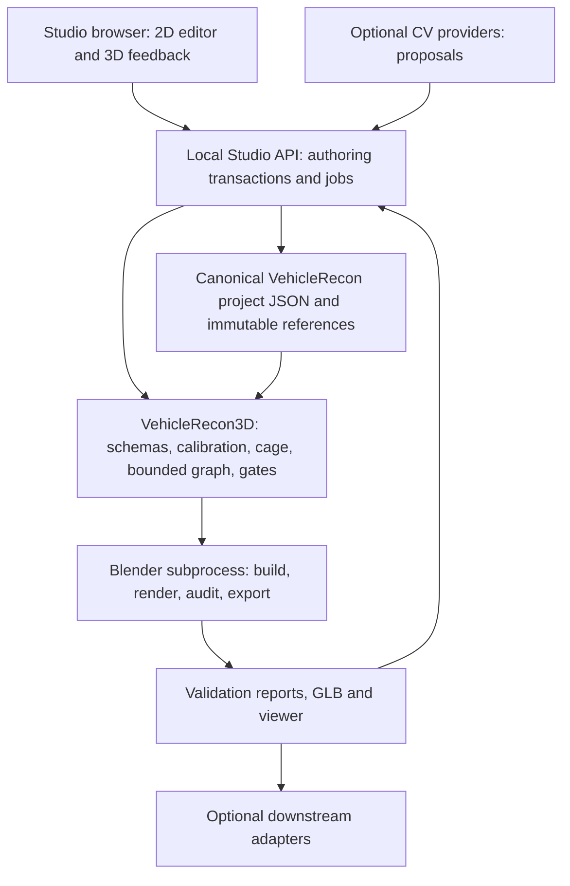

# VehicleRecon Studio architecture baseline

Implementation update, v0.1A: the [core authoring foundation](core_authoring.md)
now provides v2 contracts, editing/storage, early reviews and managed jobs.
The design-phase status below records the original architecture baseline;
the Studio HTTP backend/frontend/launch command remain unimplemented.

Status: **design complete for review; not implemented**. Base: VehicleRecon3D
[`a3592f3`](https://github.com/solluced/VehicleRecon3D/commit/a3592f33f3070f98aa8e6e1547da1bcb76c4eb15),
2026-10-16. This documentation phase changes no reconstruction code, schemas,
profiles, accepted limits, project data or Mark II evidence. The proposed
`vehicle-recon studio` command does not exist yet.

Studio is a local visual authoring frontend. VehicleRecon3D remains the Python
headless compiler, and Blender remains authoritative for built geometry. Manual
authoring works without CV, a model download, an LLM or an internet connection.
This baseline fixes ownership and contracts for review; later decisions should
supersede an ADR rather than silently change these boundaries.

## Documents and decisions

| Document | Owns |
|---|---|
| [Product](studio_product_spec.md) | Outcomes, workflow, scope, acceptance scenarios |
| [UI](studio_ui_spec.md) | Tools, layers, interaction, feedback, performance budgets |
| [Backend API](studio_backend_api.md) | Proposed operations, revisions, locks, jobs, events |
| [Data flow](studio_data_flow.md) | Canonical files, observations, edits, transactions, invalidation |
| [Security](studio_security.md) | Local trust boundary and enforcement |
| [Roadmap](studio_roadmap.md) | Dependencies, increments and release gates |
| [ADR index](adr/README.md) | Selected architecture and alternatives |

## Ownership and dependency direction



The CLI calls Core directly and remains fully functional without Studio. Core
must never import a web framework, GUI toolkit, Studio package or CV provider.
Browser code handles interaction, selection and rendering; it does not port the
reconstruction engine, PCHIP, cage solver or Coons operations to TypeScript.
The backend calls the same pure Python services used by the CLI. Heavy builds
use the existing Blender runner boundary, not browser execution.

## Proposed repository and installation boundary

```text
vehiclerecon/                         existing headless package
schemas/                             existing canonical contracts; future core migrations
profiles/                            existing automobile roles and validation floors
studio/                              future separate workspace; absent in this phase
  frontend/
    src/{app,editor2d,preview3d,commands,forms,providers,api}/
    tests/
  backend/
    pyproject.toml                    optional vehiclerecon-studio distribution
    src/vehiclerecon_studio/
      {api,workspace,transactions,jobs,events,cv}/
    tests/
  shared/
    generated/                       OpenAPI client and schema-derived types; not editable truth
    ui_metadata/                     labels/groups/widgets keyed by canonical schema paths
adapters/                            future independent downstream packages
docs/studio_*.md
docs/adr/
```

The optional Studio distribution depends on the headless package and ships
prebuilt static frontend assets. Node is a development/build dependency, not a
runtime prerequisite for CLI or Blender batch jobs. A future lazy CLI subcommand
loads Studio only when invoked and reports installation instructions if absent.
No Studio dependency is added to the current core installation. Core unit CI
stays separate from optional Studio/browser/CV jobs; existing headless Blender
and browser integration regressions retain their current runtime requirements.

## Technology decisions

These are engineering recommendations for this workload, not performance claims
established by a prototype. Pin versions and verify licenses at implementation;
the choices do not depend on a particular current release number.

| Frontend | Strength for this editor | Cost / risk | Decision |
|---|---|---|---|
| React + TypeScript | Typed command/store boundary, composable schema forms, external-store subscriptions | Canvas objects must stay outside component state; careless updates can repaint too much | Selected for shell, inspectors and accessible controls |
| Vue + TypeScript | Strong component/forms model; shallow reactive state can accommodate large datasets | Must likewise keep scene objects out of deep reactivity; equally viable if team expertise favors it | Valid alternative, no performance disqualification |
| Vanilla TypeScript | Small runtime and direct pointer/render control | Must build application lifecycle, forms, accessibility and store subscriptions ourselves | Use inside render/tool adapters, not the whole application |

React documents [external-store subscriptions](https://react.dev/reference/react/useSyncExternalStore);
Vue documents [large-data reactivity strategies](https://vuejs.org/guide/best-practices/performance).
Neither removes the need for a bounded redraw strategy. React is selected to
reduce application plumbing while leaving interaction rendering imperative.

| 2D option | Large-image/vector behavior | Hit testing / editing | Decision |
|---|---|---|---|
| SVG | Excellent inspectable vectors and crisp labels; many interactive DOM nodes must be profiled | Native element events; accessible handles possible | Small graphs, export and limited UI overlays |
| Raw Canvas 2D | Layered bitmap redraw, explicit camera transforms, no per-point DOM | Spatial index, picking, handles and invalidation must be built | Underlying rendering primitive; avoid rebuilding an entire scene graph |
| Konva-style Canvas scene graph | Layers, transforms, shapes, events; can disable listening on static content | Suitable custom point/spline tools; storage remains our canonical data | **Konva selected** behind an adapter |
| Fabric-style Canvas scene graph | Object transforms and selection useful for general image composition | Strong object-editing model; document-oriented serialization is unnecessary here | Viable alternative; never adopt Fabric JSON as vehicle storage |
| WebGL overlay | Useful for dense masks/heatmaps and batched points | Bespoke picking/text/context-loss behavior adds initial complexity | Extension when measured Canvas bottlenecks justify it |

Follow [Konva layer/listening guidance](https://konvajs.org/docs/performance/All_Performance_Tips.html)
and [Canvas optimization guidance](https://developer.mozilla.org/en-US/docs/Web/API/Canvas_API/Tutorial/Optimizing_canvas).
[Fabric's object model](https://www.fabricjs.com/docs/) is an evaluated alternative.
No renderer's serialization becomes the project format. A 4K image is an image
texture/bitmap, not thousands of DOM image tiles by default; larger images may
use disposable pyramids and tiles.

Three.js is selected for cage feedback, selection gizmos and verified GLB
display using its [renderer APIs](https://threejs.org/docs/). The backend supplies
sampled curves/coarse patches from core services. AUTO Bezier handles that only
Blender resolves are shown as control polygons until a Blender-derived sample
is available; never label an approximation as the final surface or topology.

The backend recommendation is Python + FastAPI/ASGI, with one local application
process and one global build dispatcher initially. It reuses Python project
validation and subprocess boundaries without a second language bridge. Serve
UI and API on the same loopback origin. Use explicit `127.0.0.1` binding;
[FastAPI's deployment options](https://fastapi.tiangolo.com/deployment/manually/)
are not permission to bind all interfaces or run multiple competing job owners.

Use REST for reads/transactions/job commands and one SSE connection per browser
tab for notifications and logs. [SSE is one-way and reconnectable](https://developer.mozilla.org/en-US/docs/Web/API/Server-sent_events/Using_server-sent_events),
which matches this command/event separation. A WebSocket is deferred until a
measured bidirectional streaming requirement exists. SSE is not used for every
pointer move. Revisioned preview requests are coalesced over ordinary HTTP.

| CV execution | Advantage | Constraint | Plan |
|---|---|---|---|
| Backend OpenCV | Shared local CPU pipeline for gradients, contours, simplification; no browser GPU dependency | Optional native installation and worker resource management | First baseline provider |
| ONNX Runtime Web, WASM/WebGPU | Optional local model inference in a worker; can use suitable GPU | Operator/model coverage and browser capabilities vary; WASM threading may need isolation headers | Capability-detected provider, WASM/manual fallback |
| Hybrid | Common proposal contract with best available provider | Coordinate/provenance normalization must be identical | Target architecture |

[OpenCV filtering](https://docs.opencv.org/4.x/d4/d86/group__imgproc__filter.html)
and [ONNX Runtime Web](https://onnxruntime.ai/docs/tutorials/web/) support this
modular direction. Browser execution is not a universal WebGPU requirement.
Model-family selection, model licenses and downloads are separate provider
decisions; Segment Anything-family models are candidates, not core dependencies.

## Existing code versus required generic extensions

| Boundary at base commit | Exists | Required before production Studio editing |
|---|---|---|
| Canonical files and JSON Schema | Project/calibration/cage/graph/details/review contracts | Typed generic authoring observations, drafts and bindings; versioned migrations |
| Calibration | Affine + accepted monotonic per-view warp; strict scale checks | Core diagnostic service for candidates without activating them |
| Cage | World landmarks, curve point arrays, symmetry/guide expansion | Stable point identity, shared landmark references, explicit tangent contract |
| Preview | Pure record/graph mathematics; Blender knows final handles | Reusable headless sampling/projection service; no TypeScript reimplementation |
| Validation | Schema/geometry/mask gates; final explicit visual review | Reference/cage acceptance gate **before surfaces**, shared by CLI and Studio |
| Pipeline | Four result statuses, content cache, logs and stages | Observer hook, cancellation contract, immutable run-input guard |
| Writes/concurrency | Safe project paths; ordinary JSON writes | Shared CLI/backend project locking, transactional multi-file save and recovery |
| Project initialization | Incomplete canonical draft with unknown dimensions | Generic draft validation and stage-readiness API, not a validation bypass |

The present cage stage's PASS means curve construction, not accepted semantic
multi-view fit. Mark II was stopped by an explicit review workflow; the current
pipeline does not automatically enforce that review before stage 06. Studio
must not pretend otherwise or fix it only by disabling a browser button. These
extensions need separate core design/implementation commits, tests and Tesla
regression before dependent Studio features ship. No such code is added here.

## Performance and extensibility

The scene store owns stable entity IDs, typed arrays, a spatial picking index
and per-layer dirty flags. React subscribes to selection and low-frequency
property changes. Pointer interaction and Canvas/Three redraws run through
`requestAnimationFrame`; dense CV and contour fitting use workers. Python
preview requests carry monotonically increasing edit sequence IDs; stale replies
are discarded. See [UI budgets](studio_ui_spec.md#performance-and-accessibility).

New tools implement a tool lifecycle and emit typed authoring commands. They
reuse semantic roles and existing bounded operations. New CV providers emit
proposals. New quality modes consume inspected geometry/artifacts. A new core
operation needs its own reusable contract and tests; a UI plugin cannot inject
Python, JavaScript, shaders or shell expressions through project data.

## Downstream boundary and phase outcome

Reconstruction does not yet certify a generic game-ready vehicle. Future
adapters consume verified exports plus explicit capability metadata and reject
missing LODs, collisions, UVs or hierarchy requirements. Cyberpunk 2077-specific
hierarchy/material/collision/packaging belongs in `adapters/cyberpunk2077/`, not
in the Studio core or reconstruction algorithms. No adapter, FBX capability,
Electron or Tauri requirement is implemented or promised by this phase.

Mark II remains **REFERENCE SOURCE: INCONSISTENT**, cage **FAIL**, portability
**BLOCKED**, surfaces/details **NOT STARTED**. Its active calibration and rejected
candidate evidence are unchanged. The architecture demonstrates how Studio
would expose this failure earlier; it does not change the vehicle's acceptance.
