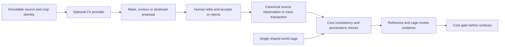

# Studio data ownership and authoring flow

Status: design contract only. Existing v1 files are unchanged. Proposed core
authoring extensions below require separate versioned implementation and tests;
examples must not be pasted into a v1 project and assumed to work.

## Canonical ownership

| File / record | Owns | Studio behavior |
|---|---|---|
| `project.json` | Identity, profile, dimensions/provenance, roles, paths, policy | Edit through schemas; preserve unknown measurements in a validated draft |
| `input/*` | Original imported source bytes | Immutable, hash-addressed references; replace by importing a new identity |
| Configured `generated/calibration.json` | Source identities/crops, observations, metric mapping, accepted warp, axles/datums | Observations and active transform are different entities |
| Configured `generated/cage.json` | Shared world geometry, semantic curves/landmarks, sections, symmetry/guides | No world coordinates authoritative in UI/session files |
| Configured `generated/surface_graph.json` | Bounded operations, boundaries, patches, sampling/materials | Schema-driven graph commands, no user code |
| Configured `generated/details.json` | Supported detail components | Reuse core operation vocabulary |
| Configured `generated/silhouette_traces.json` | Accepted independent source silhouettes | Accept contour proposal explicitly; never derive reference mask from the built car |
| `validation/review.json` | Existing final visual-review record | Standard core review writer, bound to actual geometry/inputs/proofs |
| Proposed `validation/reference_review.json`, `validation/cage_review.json` | Core-readable authoring acceptance evidence | Current explicit decisions; proposed schemas/gates, not Studio-only truth |
| Proposed `validation/rectification_candidates/*.json` | Candidate calibration and diagnostic/reviewer evidence | Inactive unless explicitly accepted into canonical calibration |
| `.studio/session.json` | Pane layout, zoom, layer visibility/lock/opacity, selection, active tool | Reconstructible preferences only; no vehicle geometry/accepted warp |
| `.cache/authoring/*` | Recovery commands, checkpoint snapshots, previews, proposal blobs | Disposable/recoverable supporting state, not compiler inputs |
| `.cache/studio/jobs/*` | Run journals, event cursors, log indices | Runtime transport state; core reports remain authoritative results |

Canonical file paths come from `project.json`, not hard-coded `generated/`
assumptions. A checkpoint/recovery backup is explicitly a backup of canonical
documents, not `studio_project.json`. Deleting `.studio/` and transient caches
must not remove accepted observations, world geometry, measurements or decisions.
Git behavior for new runtime folders belongs to the implementation phase; no
automatic Git operation is part of Studio save/checkpoint behavior.

## Identity and proposed core authoring contract

Base v1 has numeric curve point arrays, named cage landmark XYZ, and an
unstructured per-view calibration `landmarks` object. A curve's `landmark` field
currently checks existence; it does **not** make its coordinates follow that
landmark. Mark II observation/binding tables are project evidence, not an existing
generic authoring API. Stable knots, explicit editable Bezier tangents, typed
cross-view observations, separate HERO references and generic source/cage review
are missing contracts. Studio cannot claim to reuse a service that does not exist.

Plan a generic **v2 authoring contract family**, retaining the same canonical
filenames and existing v1 support. Exact schema additions get their own core
review/migration before implementation; this phase does not change `schemas/`.
Selected semantic design:

| Concept | Proposed canonical location / rule |
|---|---|
| Source observation | `calibration.views[view].landmarks.observations`, typed IDs, source hash, full-source pixel, semantic/world correspondence, provenance, uncertainty and declared tolerance |
| Source spline | `calibration.views[view].landmarks.source_curves`; stable knots/tangents, observed versus inferred provenance |
| Measurement | Typed `calibration.datums.measurements`; source/observation references, units, authority, uncertainty, citation |
| Shared world point | Existing `cage.landmarks[id]` XYZ in metres; one value, mirrored instance by declared side |
| Curve point identity | Stable per-curve point IDs in v2; existing numeric XYZ still supported; optional named-landmark point references resolved by the core |
| Shared point reference | A reference to `cage.landmarks[id]` replaces duplicate coordinates; resolution before curve expansion/build occurs in core for both CLI and Studio |
| Explicit tangents | Typed generic core tangent/handle records in metres; existing AUTO/VECTOR semantics preserved for v1 |
| Constraints | Bounded typed datum/symmetry/distance/axis relationships in core authoring contracts; no expression language |
| Draft readiness | Core draft schema/API with explicit nullable unknowns and stage-specific readiness; full build schemas stay strict |
| Optional HERO asset | Versioned optional reference role; existing combined-sheet HERO crop can already be displayed as context |

A binding identifies document kind, entity ID, point ID and instance side, never
only an array offset. On legacy v1 data, an index is usable only with its exact
document revision; it becomes stale on insertion/deletion. Studio must disable
unavailable stable-binding operations until migration rather than silently
attaching an observation to a different knot.

Conceptual v2 fragments, **synthetic examples, not a vehicle definition**:

```json
{
  "observation": {
    "id": "obs-side-a-roof-left",
    "world_landmark": {"id": "A_PILLAR_ROOF", "side": -1},
    "pixel": [500, 200],
    "uncertainty_px": 5,
    "tolerance_px": 5,
    "visibility": "observed",
    "provenance": {"method": "manual", "authority": "measured"}
  },
  "world_landmarks_fragment": {"A_PILLAR_ROOF": [0, 0.5, 1]},
  "curve_point_reference_fragment": {"landmark": "A_PILLAR_ROOF"}
}
```

The containing observation view identifies the immutable source hash. The named
world point is the authored canonical half where symmetry applies; curve instance
signs derive from existing side expansion. Observation side -1 links the mirrored
instance, not a new XYZ. Asymmetric geometry requires an explicit geometry/constraint
change with a new world entity, never an automatic per-view copy. Semantic roles
come from core profiles and owning curve/patch bindings; qualifiers such as
`roof_corner` do not form a competing Studio role registry.

## Coordinates, observations and residuals

Source coordinates are decoded original-image pixels, origin top-left, u right,
v down, matching core calibration. Crops retain original offsets. Display zoom,
pan, CSS/device pixels, EXIF/display orientation and rectification-preview
coordinates are adapters, not stored observation locations. World is metric
X longitudinal, Y lateral, Z up. Unit conversion is presentation only.

For a shared landmark instance, the backend calls the core's
`CalibrationTransform.world_to_pixel(view, X, Y, Z)`, including only the accepted
source rectification. Residual is `(projected - observed)` in original pixels;
report dx, dy and Euclidean norm against that observation's tolerance. A candidate
diagnostic has its own candidate/revision tag and never replaces this result.
Confidence cannot change tolerance. Observed, inferred, occluded and unobserved
are explicit provenance/visibility states; a missing observation is not zero error.

`MoveObservation` changes measured pixels only. `MoveWorldLandmark` changes one
canonical XYZ and all references/instances resolve to it. `SetCalibration`
changes the image/world relation. They are separate commands with different
consequences. A 2D source point is rank-two evidence; world movement needs an
explicit movement plane/axis/depth or supported multi-view constraint solve.
Preview and committed diagnostic calculation both use core Python services.
Browser rendering consumes samples/results and discards stale request sequences.

## Proposal acceptance flow



Proposal envelopes carry provider/capability/version/model hash, source hash,
crop/coordinate transform, request revision, confidence, optional seed inputs,
parameters, warnings and output artifact IDs. A proposal can be stale or rejected
without losing authored content. Acceptance maps a selected proposal to canonical
observations/traces as one undoable command, retaining provenance. A body mask
cannot silently become surface geometry. No CV model owns vehicle dimensions.

Rectification candidates use the existing `piecewise_monotonic` data fields,
with source/calibration/observation hashes and fit/held-out landmark IDs. The core
interpolator diagnoses even rejected candidates; `AxisRectification` enforces
the declared active scale limit. Acceptance validates exact datum anchors,
monotonicity/derivative, local-scale bounds, magnitude, extrapolation and held-out
evidence, then transactionally copies only the accepted transform into canonical
calibration. Reject changes the decision record only. A Preview checkbox is UI
state. The current Mark II candidate stays rejected and unchanged.

## Commands, undo and recovery

Each command includes an operation ID, base revision, typed target IDs,
preconditions, before/after values or invertible deltas, and an intent/reason.
Examples: MoveObservation, MoveWorldLandmark, AddSplinePoint, DeleteLandmark,
SplitCurve, MergeCurves, ChangeSemanticRole, SetTolerance, AddRectificationAnchor.
The backend resolves all IDs against the asserted revision and derives complete
document changes, including dependencies. No endpoint executes an arbitrary
function name or project-supplied script.

A drag coalesces pointer samples into one command. Split/merge/delete updates
references atomically or fails with affected dependencies. Undo applies the
inverse through the same validator; redo applies the original command to its
expected state. Neither regenerates the whole project or bypasses locks. An
external edit ends the current replayable history branch until reload/rebase.
Undo after autosave creates a new canonical revision; it does not resurrect an
old accepted review. Hash-equivalent files still require gate/review verification.

Committed history is a bounded recovery journal of command deltas and canonical
revisions under `.cache/authoring/`, not another buildable geometry file. Unsaved
draft operations may be recovered only by explicit replay against their matching
base; they are never imported automatically by the compiler. Session preferences
under `.studio/` contain no such authoritative geometry.

Default autosave target: after 1 s idle following a completed valid command.
Incomplete text entries and ongoing drags stay unsaved, with recoverable draft
state. Manual Save flushes a valid transaction immediately. Unsupported schemas,
external conflict, active build lock or semantic invalidity leave edits visibly
unsaved, never reported as saved. Failed saves retain the command history.

## Revisioned save and crash consistency

Project revision is a digest of sorted canonical document identities and exact
bytes, including immutable reference identities and supported schema versions;
exclude UI preferences, cache/proposals/reports and timestamps to avoid cycles.
Each evidence type has a narrower subject hash as appropriate. The API exposes
both project revision and per-document hashes; filesystem mtime is only a watch
hint. Required raw-byte hashes use preserved source bytes, not reserialized JSON.

1. Acquire a backend editor lease and the shared core OS project lock for writes.
2. Check If-Match/base revision and rehash on disk; external changes return 409.
3. Apply typed commands in memory and validate affected canonical schemas plus
   core cross-file semantics, paths, profile floors, bindings and immutable datums.
4. Write temporary files and a transaction manifest/backups on the same volume.
   Flush durable intent before replacing canonical files. Record expected old/new
   hashes and recovery state under `.cache/authoring/transactions/`.
5. Replace documents while holding the lock; publish the new revision only after
   all files and the committed manifest are durable. Notify watchers/clients.
6. Keep a bounded backup/checkpoint policy and release the lock.

Multiple filesystem renames are not magically atomic to an uncooperative reader.
CLI, backend, review writers and Blender job startup must share the core lock
and recover incomplete transactions before loading canonical data. On crash,
compare each file with recorded old/new hashes, then roll forward/back safely.
An unexpected third-party edit requires explicit conflict resolution; recovery
must not overwrite that edit with a backup. Never mark a half-written revision
as current. This shared transaction/locking service is required future core work.

Named checkpoints snapshot canonical documents and reference hashes with a
manifest under the authoring cache. Source bytes are referenced immutably, not
duplicated/reencoded. Checkpoint restore previews a diff and is a new transaction;
derived artifacts/reviews become stale according to core keys. Optional exported
checkpoint bundles can be explicitly added to Git by the user. Autosave and
checkpoint creation never commit or push automatically.

## Dirty state, cache and review invalidation

Keep separate indicators: unsaved local commands; saved canonical revision;
stale generated artifacts; stale validation; stale final review. Core cache
keys/hits determine whether existing output bytes remain reusable. Studio can
show an early dependency estimate but may not manufacture SKIP or patch hashes.

| Edit | Current conservative invalidation to display |
|---|---|
| Pane zoom/layers/selection | No compiler invalidation |
| Reference identity/content | References and dependent calibration/overlay/cage/build chain |
| Calibration, accepted warp or observations stored there | Calibration and dependent cage/surfaces; associated evidence/review |
| Cage/shared XYZ/curve | Cage and downstream surfaces, masks, details, audit, review/export |
| Surface graph | Surfaces and downstream stages |
| Details | Details and downstream audit/review/export; preserve reusable surfaces |
| Source silhouette trace/policy | Relevant mask/validation dependencies and bound review |
| Viewer title only | Viewer/delivery under existing core slices |
| Rejected candidate outside active calibration | Candidate diagnostics/review only; active geometry/cache keys unchanged |

The existing core hashes whole calibration data; do not promise an observation
edit will preserve its downstream cache until a separately tested optimization
exists. Schema UI metadata/session changes are not compiler inputs. A report
from another revision/run may be viewed historically but cannot be displayed as
current. Final visual review uses existing model/geometry/proof hash checks.

Proposed reference review binds source images, typed observations, scale
provenance, active calibration, uncertainty/acceptance policy and inspected proofs.
Proposed cage review additionally binds shared cage geometry, required critical
coverage and residual proofs. Both must be current before surfaces. These generic
headless gates complement the existing final review; construction PASS alone
does not satisfy them. Source rejection remains a first-class disposition.

## Build input and artifact flow

Save valid changes, obtain the shared lock, verify stage readiness and accepted
authoring evidence, and pin exact run input hashes. The single dispatcher invokes
the existing core pipeline with allowlisted options. Each stage rechecks the
pinned snapshot; an external writer ignoring the lock invalidates the run. Old
artifacts remain historical; neither a successful old mask nor a stale review
is transferred to the changed inputs. Unexpected changes stop dependent work
and prohibit current export/delivery.

The backend relays native results/logs and verifies report identities. Browser
loads only a GLB that passed stage 12 for that run; export URLs are opaque artifact
IDs bound to hashes. Three.js shows authoring feedback before then; Blender's
built topology/surfaces remain authoritative. Downstream adapters independently
check required scale, hierarchy, LOD, collision, UV/material and packaging
capabilities; reconstruction success alone does not certify Cyberpunk readiness.

## Versioning, external edits and migration

API version and document `schema_version` are independent. Existing v1 projects
remain readable/buildable through the core without Studio. Future v2 authoring
features need explicit migration preview, source/target schema IDs, backups,
deterministic ID assignment, semantic validation and full Tesla regression.
Migration is a separate transaction, never an incidental side effect of Open.
Unknown newer documents open read-only with safe metadata/raw inspection and
an explanation; no serializer may discard unknown fields and overwrite them.

The current `init` writes an intentionally incomplete v1 draft, rejected by full
`Project`/preflight. Production Studio needs the planned core draft/readiness
contract before it can save its incomplete wizard state as validated canonical
data. Do not use `Project(check=False)` as a general write-validation bypass.
The full pipeline currently expects all authoring inputs even for early stages;
stage-specific draft readiness is another explicit core prerequisite.

Watch registered canonical files, source identities and Git checkout/rename
events. Debounce notifications, then hash/validate; catch changes again at save
even if a watch event was missed. If clean, offer reload; if dirty, present a
semantic/file diff and keep both revisions. Rebase commands only after resolving
changed bindings, otherwise discard/reload explicitly. Unknown files do not
become executable plugins, references or trusted artifacts through watching.
